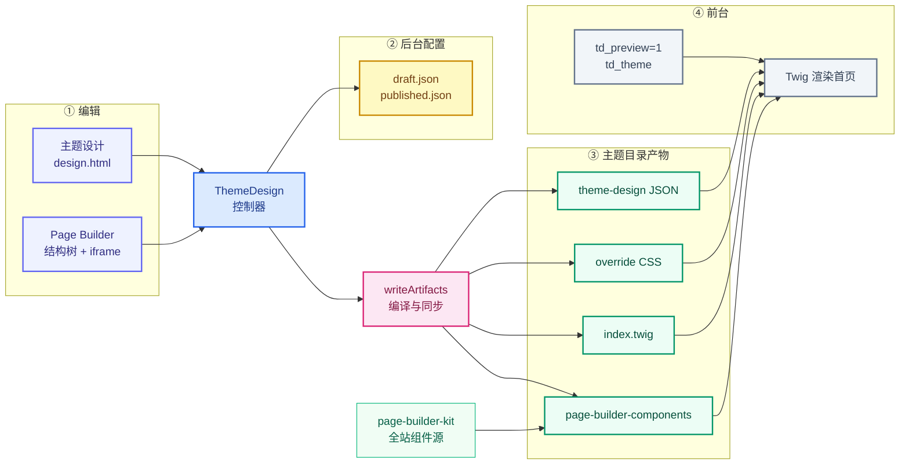
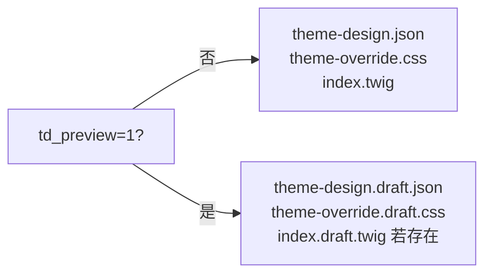

# Page Builder 架构说明

> 本文描述 MacCMS「主题设计」中 **首页组件化**、**全屏页面设计器（Page Builder）** 与 **预览链路** 的工程方案。
> 面向后端、前端与 AI 协作开发；设计侧上手见 `docs/theme-design-guide.md`，Twig 契约见 `docs/theme-spec-v2.md`。

---

## 1. 设计目标

| 目标 | 做法 |
|------|------|
| 首页可配置、可发布 | 配置存 JSON，编译为 `index.twig`，前台不运行时解析 JSON |
| 组件跨主题复用 | 统一组件库 `page-builder-kit`，发布时同步到各主题 `page-builder-components/` |
| 编辑体验接近真实站点 | 预览 iframe 加载真实前台首页，非 GrapesJS 假 DOM |
| 草稿与线上隔离 | 草稿产物带 `.draft` 后缀；仅 `?td_preview=1` 时读取 |
| 不破坏原主题 | 覆盖层：`theme-override.css` + `theme-design.json` + 编译首页，不整包替换主题 |

---

## 2. 总体架构

从左到右：**编辑 → 保存 → 主题产物 → 前台渲染**。中间不运行时解析 JSON，产物一次编译、多次读取。



| 阶段 | 关键路径 | 草稿 / 正式 |
|------|----------|-------------|
| 后台配置 | `application/data/theme_design/{theme}/` | `draft.json` → `published.json` |
| 主题叠加 | `template/{theme}/` | `*.draft.*` 仅预览；无后缀为线上 |
| 组件库 | `template/_shared/kit/` → `page-builder-components/` | 按首页实际用到的组件同步 |
| 预览 | 站点首页 `?td_preview=1&td_theme=` | 读草稿产物 + `index.draft.twig` |

**核心原则：编辑态是 JSON 树，运行态是编译好的 Twig + 静态资源。**

---

## 3. 组件化方案（Page Builder Kit）

### 3.1 源码与运行时位置

| 层级 | 路径 | 说明 |
|------|------|------|
| **Kit 源** | `template/_shared/kit/` | 全站唯一维护点，版本号 `kit.json`（当前 v38） |
| **组件包** | `kit/components/{id}/` | 每个组件一个目录 |
| **预设**(模板) | `kit/presets/default-homepage.json`、`palette.json` | 默认首页树、旧版预设面板 |
| **共享** | `kit/shared/` | peers、卡片、avatar/comment、js/css/img/svg/language（→ 主题 `_shared/`） |
| **契约宏** | `template/_shared/twig/` | 仅 `@shared`（`components.twig`、`icon.twig`） |
| **建站基座** | `template/_shared/starter/`（兼容软链 `pb-starter`） | 新建主题复制源 |
| **主题副本** | `template/{theme}/page-builder-components/` | `PageBuilderKit::syncToTheme()` 同步 |
| **版本戳** | `template/{theme}/.page-builder-kit-version` | 与 kit 版本比对，决定是否重同步 |

PHP 入口：`application/common/util/PageBuilderKit.php`

### 3.2 单组件目录约定

```
components/{component_id}/
├── component.json    # 元数据：分类、palette、assets
├── template.twig     # Twig 片段，接收 props
├── style.css         # 组件样式（编译进 head）
└── script.js         # 可选交互（defer）
```

`component.json` 示例：

```json
{
  "id": "section",
  "label_key": "admin/themedesign/pb_block_section",
  "category": "layout",
  "kind": "section",
  "peer_styles": [],
  "assets": { "css": "style.css", "js": "script.js" }
}
```

| 字段 | 含义 |
|------|------|
| `category` | 组件库分类：`chrome` / `layout` / `carousel` / `list` / `rank` |
| `kind` | 编辑器缩略图与拖拽语义 |
| `palette: false` + `kind: chrome` | 不出现在「可拖入」列表，仅 `select_only`（顶栏/页脚等固定层） |
| `peer_styles` | 需额外加载的 peer 卡片样式名 |
| `assets` | 同步到主题时要复制的文件清单 |

### 3.2.1 component.json v2 契约（机器可读）

`component.json` 是组件**唯一机器契约**；编辑器 traits、Theme AI、kit-lint 均以它为权威。

| 字段 | 含义 |
|------|------|
| `props` | 可配置项：`type`（`string`/`number`/`boolean`/`enum`/`category`）、`default`、可选 `trait`（映射编辑器控件） |
| `context.pageTypes` | 允许出现的页面类型：`home` / `list` / `detail` / `member` … |
| `context.requires` | 依赖的 Twig 上下文（如 `obj.vod_id`） |
| `data` | 数据源说明（如 `mac_vod`），首期文档化，不自动生成 Twig |
| `slots` | 布局壳组件的子块槽位 |
| `styleMode` | `component`（默认）或 `peer_only`（样式在 peer_styles） |
| `fixtures/default.json` | 黄金参考组件的最小 props + mock context |

**三层模型**

| 层 | 路径 | 说明 |
|----|------|------|
| primitive | `kit/shared/` | 卡片、宏、peers.css；不进 palette |
| composite | `kit/components/` | 可编排块（`vod_list`、`section` …） |
| shell | 如 `member_shell` | 页级容器 + slots |

**Catalog 聚合**：`PageBuilderKit::componentCatalog()` 扫描全 kit；后台 `theme_design/pb_component_catalog` 与页面设计器 `PB.componentCatalog` 消费。

**校验**：`php tests/regression/kit_lint.php`（`--write-manifest` 刷新 `kit/manifest.json`）。

**黄金参考组件**（AI / 新人 copy template）：`empty_state`、`vod_list`、`section`、`site_nav`、`vod_detail`。

### 3.3 组件清单与 manifest

`kit/manifest.json` 由 catalog **自动生成**（`kit_lint.php --write-manifest`），当前与 kit 同步约 **86** 个组件 id。下列为分类说明（非完整枚举）：

**Chrome（站点框架）**

| id | 说明 | 位置 |
|----|------|------|
| `site_nav` | 顶栏导航、搜索、Logo | `chrome[]` 或 `block site_header` |
| `header_decor` | 顶栏装饰条（宽/高/图） | `chrome[]` 或 `block hero` |
| `channel_strip` | 频道分类芯片条 | `chrome[]` 或 `block channel` |
| `site_footer` | 页脚 | 独立 `page.footer`（非 chrome 数组） |

**Layout**

| id | 说明 |
|----|------|
| `section` | 分区容器 + 标题（slots: `body`） |
| `columns` | 多列（slots: `0`、`1`…） |
| `grid` | CSS Grid 容器 |
| `spacer` | 间距 |
| `filmstrip_layout` | 左大轮播 + 右环绕卡片（slots: `banner`、`feed`） |

**Carousel**

| id | 说明 |
|----|------|
| `vod_carousel` | 视频轮播 |
| `carousel-fullbleed` | 全宽轮播 |
| `carousel-compact` | 紧凑轮播 |

**List / Feed**

| id | 说明 |
|----|------|
| `vod_list` | 视频列表（render: grid/slider/filmstrip） |
| `art_list` / `manga_list` / `topic_list` / `live_list` / `website_list` / `gbook_list` | 各内容类型列表 |
| `content_feed` | 通用内容流（bind: vod/manga/art…) |

**Rank**

| id | 说明 |
|----|------|
| `rank_list` / `rank_inline` / `rank_feed` / `rank_card` | 排行展示形态 |

### 3.4 组件树 JSON 结构

首页配置挂在 `homepage.page`：

```json
{
  "template": "index/index",
  "layout": "base",
  "chrome": [
    { "component": "site_nav", "props": { "max": 8, "show_search": true, "type_ids": [] } },
    { "component": "header_decor", "props": { "width": "100%", "height": 120, "image": "" } },
    { "component": "channel_strip", "props": { "compact": false, "chip_limit": 11 } }
  ],
  "blocks": [
    {
      "component": "section",
      "props": { "title": "热门推荐", "more_url": "vod/index" },
      "slots": {
        "body": [
          { "component": "vod_list", "props": { "num": 12, "render": "slider" } }
        ]
      }
    }
  ],
  "footer": {
    "component": "site_footer",
    "props": { "variant": "default", "show_nav": true, "show_friends": true, "logo": "" }
  }
}
```

- **叶子组件**：`component` + `props`
- **容器组件**：额外 `slots`，键名由容器定义（`body`、`banner`、`feed`、`0`/`1`…）
- **chrome**：固定顺序经 `normalizeChrome()` 合并为 `site_nav → header_decor → channel_strip`
- **footer**：独立字段，经 `normalizeFooter()` 归一化；预览 path 在全部内容块之后

### 3.5 同步机制

`PageBuilderKit::syncToTheme($themeDir, $upgrade, $onlyIds)`：

| `$onlyIds` | 行为 |
|-----------|------|
| `null` | 全量同步（脚本/测试/bootstrap） |
| 组件 id 数组 | **仅**复制页面实际用到的组件目录 + 始终同步 `_shared/`、`pb_bundles.twig` |
| 发布且 `$upgrade=true` | 额外 **剔除** 主题 `page-builder-components/` 下未使用的组件目录 |

组件 id 来源：`collectPageComponentIds($page)`，扫描 `chrome` / `blocks` / `footer` 树（与编译器 head 资源收集规则一致）。

触发时机：

- 保存草稿 / 发布：`writeArtifacts()` 在编译前按当前 `homepage.page` 按需同步
- 打开主题设计 / Page Builder：按当前草稿首页树同步（非全量 kit）

### 3.6 与主题原生组件的关系

- PB 组件 **自包含** CSS/JS，通过编译后的 `` 引入
- `_shared/css/peers.css` 提供卡片 peer 样式与无主题基底时的链接重置
- 主题 `layout/base.twig` 声明的 Twig block 决定 chrome 落点（见 §5.3）

#### 3.6.1 风格包（Theme Preset）分层

```
_shared/kit/components/        ← 原子组件（与主题无关）
_shared/kit/presets/           ← 风格包：scaffold 策略 + shell CSS + 可选 tokens overlay
_shared/kit/shared/ + twig/    ← 全站共用碎片与 @shared 宏
_shared/starter/               ← 建站默认源（thin 壳：layout + tokens；无预置组件副本）
template/{site-theme}/         ← 站长实例：info.ini 写 pb_preset，asset/css/pb-shell.css 为合并产物
```

| 层 | 职责 |
|----|------|
| **Kit** | 组件 id、props、自包含样式 |
| **Preset** | `preset.json` 定义 `scaffold.list_sidebar_rank` 等；`pb-shell.css` 覆盖版式（如侧栏双栏 grid） |
| **starter** | `pb_enabled=1`、`pb_shell=thin`、`pb_preset=preset-clean`；`ThemePreset::applyPresetToTheme()` 合并 shell → `asset/css/pb-shell.css` |
| **np2-starter** | 仅 **新建** `preset-np2` 主题时复制；含 `layout/base.twig` 底栏 tabbar、`np2-app.css`；`info.ini` 写 `pb_preset=preset-np2`，**不设** `pb_protect_kit_assets` |
| **主题实例** | `draft.json` 可存 `attributes.preset_id`；`PageScaffolder` 按 preset scaffold 生成 31 页 JSON |

**三选一网站版式**（主题设计概览 `td-preset-grid`）：`preset-clean` | `preset-sidebar` | **`preset-np2`**。

`preset-np2` 要点：

- `scaffold.site_header_chrome = app_top_chrome`：`PageScaffolder` 将顶栏写入 **`site_header`** 区（非 `content` 首部）；`footer` 空，底栏由 `np2-starter` 的 `base.twig` 渲染。
- 默认配色方案 `default_scheme: midnight`；`bootstrapPbPages` / `mergePbDraftAttributes` 在站长未改色时写入 `attributes.color_scheme`。
- **双顶栏切换**（站点 chrome 步骤 / 设计器）：`site_nav`（标准 `.hd`）↔ `app_top_chrome`（NP2 `.np2-top`），互斥落在 `site_header`；`ThemeDesign::applyHeaderChromeToDraftPages()` 全站同步。
- **旧草稿**：`content` 内遗留 `app_top_chrome` 在保存时由 `PageBuilderKit::applyAppTopChromeLayout()` / 前端 `stripAppTopChromeFromCollectedPage()` 迁移至 `site_header`。
- **存量 `template/np2/`** 不迁移；仅新建主题走 preset 路径。对照用 `self_operated_np2_merge_smoke.php`。

**Thin 壳加载顺序**（`ThemePreset::emitShellTagsForCompile()`，由 `TwigPageCompiler` 在 `components_only` 时输出）：

1. `asset/css/tokens.css`（主题基底 token）
2. `mac_theme_override_css_href()`（主题设计配色覆盖，若有）
3. `asset/css/pb-tokens-overlay.css`（preset 深色等 overlay，若有）
4. `asset/css/pb-shell.css`（合并壳样式）

**兼容回退**：无 `pb_preset` / 无 `pb-shell.css` 的旧 thin 主题（如早期 `pb-sandbox`）仍回退 `sandbox.css` 一个版本。

**建站向导**：`ThemeDesign::createOrUpdateNewTheme` / `publishAsNew` 复制 `_shared/starter`（兼容名 `pb-starter`）而非 `pb-sandbox`，接受 `preset_id`，并 `bootstrapPbPages()` 批量 scaffold + 编译 draft。

- `pb-sandbox` 标 `role=dev`，仅作开发试点与三 preset A/B 对比，不作站长默认建站源
- thin 主题编译时 `components_only`：由 `ThemePreset::isThinShell()` 判定，清空原生 `theme_styles`，仅加载上述 PB 壳 + 组件样式

---

## 4. 页面设计器方案（Page Builder）

### 4.1 与「主题设计向导」的关系

| 入口 | 文件 | 用途 |
|------|------|------|
| **主题设计** | `application/admin/view_new/themedesign/design.html` | 分步：站点属性 / 导航 / 页脚链接 / 首页概览；每步 iframe 预览 |
| **Page Builder** | `application/admin/view_new/themedesign/page_builder.html` | 全屏首页搭建：组件库 + 结构树 + 实时预览 + 属性 |

两者共用：

- 配置根：`application/data/theme_design/{theme}/draft.json`
- 保存 API：`ThemeDesign::save_step`（`step=homepage` 时写入 `homepage.page`）
- 产物生成：`writeArtifacts()`

Page Builder 打开时会先 `compileHomepageIndexTwig($cfg, true)` 生成 `index.draft.twig`，保证 iframe 有最新编译结果。

### 4.2 前端用到的内容

| 部分 | 实现 |
|------|------|
| 结构编辑 | GrapesJS 0.21（`static_new/js/themedesign/page-builder.js`） |
| 组件类型 | 自定义 `mcms-block`，**不**用 GrapesJS 渲染真实内容 |
| 真实预览 | 中央 `<iframe id="pb-preview">` 加载前台首页 |
| 属性面板 | GrapesJS Traits + 自定义 DOM（分类多选、Logo/装饰图上传） |
| 缩略图 | `static_new/svg/themedesign/thumbs/*.svg` + `page-builder-thumbs.js` 加载 |
| 样式 | `static_new/css/themedesign/page-builder.css` |

布局：**左** 组件库与结构树 | **中** 缩放预览 iframe | **右** 属性与 Chrome 专用面板

### 4.3 编辑交互

1. **拖入**：从左侧组件库拖到预览区，松手在落点插入完整区块（非 GrapesJS 内部子节点编辑）
2. **结构树**：右侧 GrapesJS Layer Manager，支持排序、选中、↑↓ 移动
3. **Chrome 层**：`site_nav` / `header_decor` / `channel_strip` / `site_footer` 固定存在，`removable=false`，不可拖出内容区
4. **属性**：Traits 改 `props`；`site_nav` Logo、`header_decor` 图片、`site_footer` Logo 用 Layui Upload（`theme_design/upload`）
5. **分类**：`site_nav` / `channel_strip` 共享 `type_ids`，面板多选顶级分类
6. **自动保存**：`scheduleAutoSave()` 防抖 700ms → `save_step` + 刷新预览

### 4.4 数据流（保存）

```
GrapesJS 模型树
    → collectPage() 序列化为 homepage.page（chrome / blocks / footer）
    → POST save_step { step: 'homepage', data: JSON.stringify({ page }) }
    → ThemeDesign::sanitizeHomepagePage()
    → 写入 draft.json
    → writeArtifacts(true)
        → theme-override.draft.css
        → theme-design.draft.json
        → sync page-builder-kit
        → index.draft.twig（previewMarkers=true）
    → 前端 refreshPreview() 重载 iframe
```

### 4.5 后端校验要点

`ThemeDesign::sanitizeBlockProps()` 按组件白名单过滤 props；图片/Logo 路径经 `mac_filter_xss` 与路径字符限制。

允许的组件名：`PageBuilderKit::componentNames()`（kit 打包 + manifest 遗留名）。

---

## 5. 编译方案（TwigPageCompiler）

入口：`application/common/util/TwigPageCompiler.php`

### 5.1 输入与输出

| 输入 | 输出 |
|------|------|
| `homepage.page` JSON 树 | 完整 `html/index/index.twig` 或 `index.draft.twig` |
| `$previewMarkers === true`（草稿） | 每个区块外包 `<div class="pb-block-host" data-pb-path data-pb-component>` |
| `$layoutOpts` | 控制 chrome 写入哪个 Twig block |

编译是 **保存/发布时一次性生成**，前台 Twig 直接 `include page-builder-components/.../template.twig`，无运行时 JSON 遍历。

### 5.2 生成模板结构

```twig
{# Generated by Theme Design Page Builder — do not edit manually #}

 home

  <link rel="stylesheet" href=".../_shared/css/peers.css">
  <link rel="stylesheet" href=".../site_nav/style.css">
  ...

 ... site_nav ...    {# 若 layout 声明 #}
 ... header_decor ... 
 ... channel_strip ... 
 ... blocks 树编译结果 ... 
 ... site_footer ... 
```

### 5.3 `themeLayoutBlockMap()` 与 base.twig

扫描 `html/layout/base.twig` 是否包含：

| block 名 | 有则编译进 block | 无则 fallback |
|----------|------------------|---------------|
| `site_header` | `` | 插入 `content` 顶部 |
| `hero` | `` | 插入 `content` 顶部 |
| `channel` | `` | 插入 `content` 顶部 |
| `footer` | `` | 不输出页脚块 |

### 5.4 预览 path 编号

用于编辑器与 iframe 双向定位：

```
path 0   → site_nav
path 1   → header_decor
path 2   → channel_strip
path 3…  → blocks[0…]（容器内为 3/body/0 等）
path N   → site_footer（N = chrome 数 + blocks 数）
```

---

## 6. 预览方案

### 6.1 两套预览 UI

| 场景 | 容器 | 刷新方式 |
|------|------|----------|
| 主题设计各步骤 | `design.html` 内 `.td-live-frame` | 点击「刷新预览」→ `ThemeDesign::preview()` |
| Page Builder | `#pb-preview` iframe | 自动保存后 `refreshPreview()`，或手动刷新 |

两者最终 URL 形态一致（见下）。

### 6.2 预览 URL 参数

```
https://{站点首页}?td_preview=1&td_theme={主题目录名}
```

| 参数 | 作用 |
|------|------|
| `td_preview=1` | 进入预览模式：读草稿配置与草稿产物 |
| `td_theme` | 强制用指定主题目录渲染（可与站点当前激活主题不同） |

生成：`ThemeDesign::previewUrl()` / `preview()` API。

### 6.3 预览模式下的文件选择



关键 PHP：

- `mac_theme_design()` — 读 `theme-design[.draft].json`（`application/common.php`）
- `mac_td_preview_mode()` — 是否预览
- `mac_td_index_template()` — 预览且存在 `index.draft.twig` 时用 `index/index.draft`
- `application/common/behavior/Init.php` — `td_preview` 时切换 `template_dir`
- `application/common/behavior/PreviewLinks.php` — 注入脚本，站内链接保持预览参数

### 6.4 Page Builder 预览联动

1. **编译草稿 Twig**：`index.draft.twig` 带 `pb-block-host` 包裹层
2. **iframe 加载** 带 `td_preview=1&td_theme=...` 的真实首页
3. **选中结构树节点** → `scrollPreviewToPath(path)` 滚动并高亮 `.pb-block-selected`
4. **点击预览区区块** → `wirePreviewIframe()` 反选 GrapesJS 模型
5. **拖拽落点**：读取 iframe 内 `data-pb-path` 计算插入位置（`pb-preview-drag-overlay`）
6. **视口**：桌面 1920px / 手机 375px 缩放（`fitPreviewScale`）

预览 **不是** GrapesJS 的 `canvas` 渲染，而是 **真实 PHP + Twig + 数据库内容**。

### 6.5 发布 vs 草稿

| 操作 | draft.json | published.json | 主题目录产物 |
|------|------------|----------------|--------------|
| 保存步骤 / PB 自动保存 | 更新 | — | `*.draft.*` |
| 发布 | 同步 | 更新 | 正式 `theme-design.json`、`index.twig` 等 |

访客正常访问（无 `td_preview`）永远只看 **已发布** 产物。

---

## 7. 配置与产物文件一览

### 7.1 后台数据（按主题）

```
application/data/theme_design/{theme}/
├── draft.json          # 完整设计配置（含 homepage.page 树）
├── published.json      # 已发布配置
└── history/            # 历史快照
```

### 7.2 主题目录产物

```
template/{theme}/
├── theme-design.json / theme-design.draft.json
├── asset/css/theme-override.css / theme-override.draft.css
├── html/index/index.twig / index.draft.twig
├── page-builder-components/          # kit 同步副本
└── .page-builder-kit-version
```

### 7.3 `theme-design.json` 与 `homepage.page` 的分工

| 数据 | 位置 | 用途 |
|------|------|------|
| 全局 Logo、版权、头像 | `draft.json` → `attributes` → 写入 `theme-design.json` 的 `logo` / `footer_copyright` | `mac_theme_design()`，组件 props 空时回退 |
| 导航分类 | `navbar.type_ids` | 同步到 chrome 的 `type_ids` |
| 首页区块树 | `homepage.page` | 编译 `index.twig` 的唯一来源 |

---

## 8. 关键代码索引

| 模块 | 路径 |
|------|------|
| 控制器 | `application/admin/controller/ThemeDesign.php` |
| Kit | `application/common/util/PageBuilderKit.php` |
| 编译器 | `application/common/util/TwigPageCompiler.php` |
| PB 前端 | `static_new/js/themedesign/page-builder.js` |
| PB 视图 | `application/admin/view_new/themedesign/page_builder.html` |
| 主题设计向导 | `application/admin/view_new/themedesign/design.html` |
| 预览行为 | `application/common/behavior/Init.php`、`PreviewLinks.php` |
| 主题设计读取 | `mac_theme_design()`、`mac_td_index_template()` in `application/common.php` |

---

## 9. 扩展新组件 checklist

1. 在 `template/_shared/kit/components/{id}/` 添加 `component.json`、`template.twig`、`style.css`（及可选 `script.js`、静态资源）
2. 在 `PageBuilderKit::defaultPropsForComponent()` 增加默认 props
3. 在 `ThemeDesign::sanitizeBlockProps()` 增加 props 白名单（若需校验）
4. 在 `page-builder.js` 的 `traitsFor()` 增加 Traits；特殊字段用独立上传面板
5. 在 `static_new/svg/themedesign/thumbs/<component_id>.svg` 增加 wireframe 缩略图，并在 `page-builder-thumbs.js` 的 `THUMB_IDS` 注册
6. 9 语言 i18n：`admin/themedesign/pb_block_*`、`pb_trait_*`
7. 若新容器：在 `TwigPageCompiler::compileBlock()` 增加编译分支
8.  bump `kit.json` version，对目标主题执行 `syncToTheme`（或发布一次让 `writeArtifacts` 按需同步）

---

## 10. 相关文档

- `docs/theme-design-guide.md` — 主题继承与交付检查（设计侧）
- `docs/theme-spec-v2.md` — Twig 变量与工程契约
- `docs/twigspike-componentization-report.md` — 早期组件化调研（历史参考）
